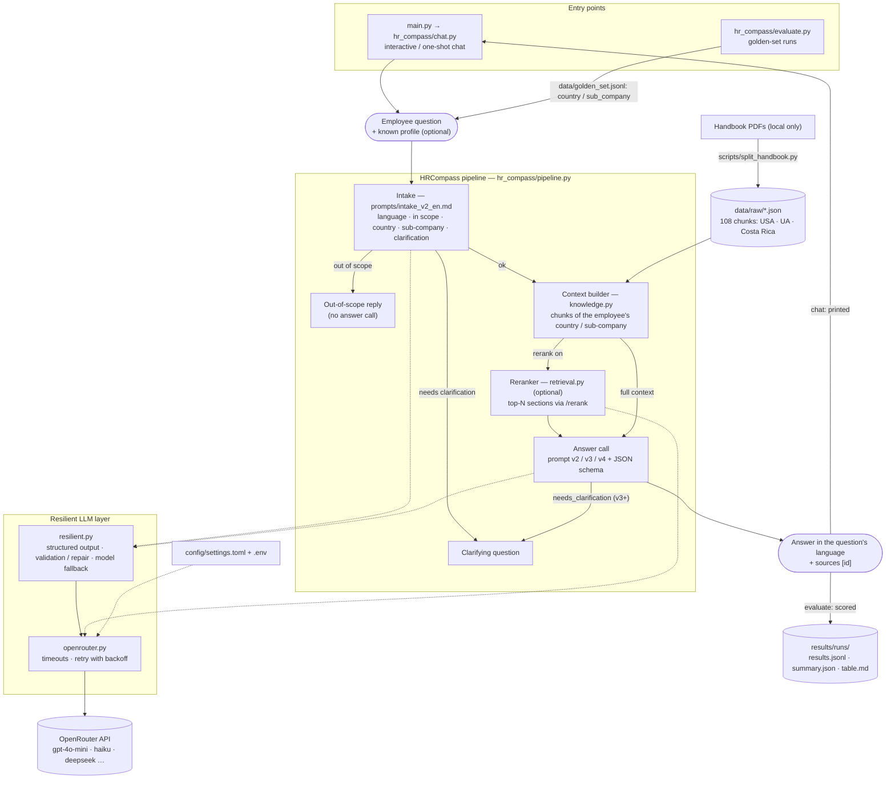

# HR Compass

**English** | [Українська](README.uk.md)

An HR bot: an assistant for employees that answers questions about the company.
End-to-end project of the AI Engineer course.

## Repository structure

```
main.py           entry point
hr_compass/       service code
prompts/          prompt versions + CHANGELOG.md
data/             texts (knowledge base) and golden set
scripts/          splitting a PDF handbook into chunks (split_handbook.py)
results/          model outputs
tests/            tests
REPORT.md         comparison report
```

## Diagram



Fallbacks not shown on the diagram: no chunks for the profile → the whole handbook is used; the rerank request
fails → the full context is used; intake fails → the bot answers without it.

## Requirements

- Python 3.11+

## Run

```bash
python -m venv .venv
.venv\Scripts\activate          # Windows; Linux/macOS: source .venv/bin/activate
pip install -r requirements.txt  # or make install
cp .env.example .env             # put your keys in
python main.py                   # or make run
```

After the one-time setup, `python main.py` works from any new shell, even without activating `.venv`: if the current
Python has no project dependencies, `main.py` re-runs itself with `.venv`'s Python (and prints the setup steps if there
is no `.venv` yet).

## How the service works

```
question (in any language)
  → intake (prompts/intake_v2_en.md): language, in scope or not, country/sub-company, whether a clarification is needed
  → context: the whole handbook (data/raw) or, with --rerank, the top-N sections from the reranker
  → answer: context in the system prompt + question → JSON by the schema
  → answer text in the language of the question + sources [id]
```

- Out of scope — a polite refusal without calling the main model (saves tokens).
- Clarification needed — the bot asks one question; the next message is merged with the original question.
- If the handbook has no sections for the country/sub-company from intake — the whole handbook is used.
- If intake fails — the bot answers without it.

```bash
python main.py                                  # interactive chat (quit: exit)
python main.py "How many vacation days do part-time employees get?"   # a single question
python main.py "..." --model haiku --debug      # model alias; intake, tokens, cost
python main.py "..." --no-intake                # without intake
python main.py "..." --rerank                   # only the top-N relevant sections instead of the whole handbook
```

Models are set by aliases in `[models]` of `config/settings.toml` (or by a full OpenRouter slug).

### Reranker (`[rerank]` section)

Instead of the whole handbook (~27k tokens), only the `top_n` sections that the rerank model
(`nvidia/llama-nemotron-rerank-vl-1b-v2:free` via OpenRouter `POST /rerank`, free) considers most relevant to the
question go into the prompt. Disabled by default (`enabled = false`); enable it in the config or with the `--rerank` /
`--no-rerank` flag (both in `main.py` and in `hr_compass.evaluate`). The rerank request has the same timeouts/retries as
the main model; if it still fails, the answer is built from the full context. In evaluation, runs with rerank have the
`_rerank` suffix in the folder name, and the `retrieved` field in `results.jsonl` holds the ids of the selected sections.

```bash
python -m hr_compass.evaluate --prompt prompts/v2_structured.md --rerank   # compare with the same run without --rerank
```

## Logging

The log is written to `logs/hr_compass.log` (rotation 1 MB × 3; `*.log` is in `.gitignore`) and to the console (stderr).
For the chat the console shows only WARNING+, the file INFO+; `--debug` enables DEBUG in both.
The path is changed with `--log-file <path>` or the `HR_COMPASS_LOG_FILE` variable; `off` disables the file.

What is logged: loading of the config and the handbook, every model call (model, attempt, tokens, cost, latency),
retries/refusals/fallback, the intake result, pipeline decisions (out of scope / clarification / answer, sources, total
cost), session start and end. Every question (or evaluation sample) has a short id in square brackets, so all lines of
one request are easy to collect.

Privacy: the API key is never logged; the question text gets into the log only at DEBUG level (at INFO — only its length).

## Comparing models

```bash
make compare MODELS=haiku,deepseek              # or: python -m hr_compass.evaluate --prompt prompts/v2_structured.md --models haiku,deepseek
```

Each model is run separately (fallback disabled, so the model is never replaced by another one), results go to
`results/runs/`, the summary table for `REPORT.md` — to `results/runs/<time>_compare_<prompt>.md`.

## The whole evaluation in one command

```bash
python scripts/run_all.py            # or make run-all: prompts v2, v3, v4 × models gpt4omini, haiku, deepseek
python scripts/run_all.py --clean    # first delete previous runs from results/runs/
python scripts/run_all.py --prompts v3_country_clarification --models deepseek --limit 3   # quick check
python scripts/run_all.py --rerank   # the same matrix with the reranker
python scripts/run_all.py --summary-only   # only rebuild results/summary.md from the existing runs
```

Each prompt is one `hr_compass.evaluate --models ...` call (fallback off, intake on). At the end the script writes
`results/summary.md` — one row per new run with the report columns (correct, reply type, per country, clarification
without a country, language = question, tokens, p50/p95, run cost and cost per 1000 questions). Like `main.py`, it
works without activating `.venv`. `v1_baseline` is not in the default matrix (it needs
`[structured_output].enabled = false`, pass such a `--config`).

## Evaluating prompts via OpenRouter

1. Put `OPENROUTER_API_KEY` into `.env` (the only secret).
2. All other settings are in `config/settings.toml` (model, concurrency, reliability patterns below).
3. Add questions to `data/golden_set.jsonl` (the format is described in the file's comments).
4. Run:

```bash
make eval
python -m hr_compass.evaluate --prompt prompts/v2_structured.md --samples data/golden_set.jsonl --limit 3
```

Every question goes the same way as in the chat: intake → context → answer. `country` / `sub_company` from the golden
set is the employee profile known to the bot in advance (a country named in the question itself takes precedence).
`expected_kind` (`answer` / `clarification` / `out_of_scope`) checks the reply type — the "Reply type, %" column.
`--no-intake` calls the answer model directly (then every reply is an `answer`); intake is also switched off
automatically if `[structured_output].enabled = false` (e.g. for `v1_baseline`). Cost and tokens include the intake call.

Results: `results/runs/<time>_<model>_<prompt>/results.jsonl` (answer, reply type, sources, confidence, model, tokens, cost, latency) and `summary.json`
(sampling parameters of the run from `[generation]` — `temperature`, `top_p`, `max_tokens`; latency — mean, p50 and p95
over successful samples; percentiles are nearest-rank, so on a small sample p95 ≈ the slowest request).
The exit code is non-zero if at least one request failed.

### Reliability patterns (`config/settings.toml` sections)

| Pattern | Section | What it does |
|---|---|---|
| Timeout | `[timeout]` | connect/read/write/pool timeouts + a hard deadline for one attempt (`attempt_s`) |
| Retry with backoff | `[retry]` | retry on 429/5xx/timeouts: `base_delay_s * multiplier^n`, capped by `max_delay_s`, jitter, `Retry-After` |
| Structured output + validation | `[structured_output]` | `json_schema` in the request, pydantic validation (`hr_compass/schema.py`), `max_repair_attempts` repair requests |
| Fallback | `[fallback]` | if a model ran out of attempts or returns invalid JSON — the next one from `models`; not for `skip_statuses` (401/402/403) |

For free text (`prompts/v1_baseline.md`) disable `structured_output.enabled`.
