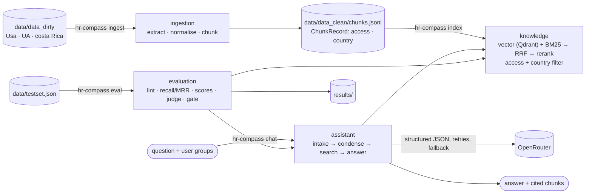

# HR Compass

**English** | [Українська](README.uk.md)

An HR bot: an assistant that answers employees' questions from the company's own documents (RAG), cites the
documents it used, says when they do not cover a question, and never shows a document the employee may not read.
End-to-end project of the AI Engineer course.

## Repository structure

```
main.py              entry point: python main.py = the chat (make run); python main.py run = the full pipeline (make pipeline)
hr_compass/          the service, one package per bounded context (see Architecture)
config/              settings.toml (every tunable number), access.json (who may read what),
                     experiments/ (one config per chunking variant: headings / fixed × 120 / 250 tokens)
prompts/             prompt versions + CHANGELOG.md
data/                testset.json (golden set); data_clean/chunks.jsonl + manifest.json (anonymised chunks, in git);
                     data_dirty/ (source documents) and experiments/ (chunking variants) are git-ignored
results/             evaluation results and baselines; experiments/<variant>/ (chunk stats + retrieval of each variant)
tests/               tests, mirroring the package
.github/workflows/   CI: ruff + pytest on every push and pull request
REPORT.md            model comparison report
```

## Architecture

Domain-driven design, one package per bounded context, each with three layers:

| Context | Domain (pure) | Application (use cases, ports) | Infrastructure (adapters) |
|---|---|---|---|
| `ingestion` | normalise, chunk, dedup, document metadata | `IngestDocuments` (incremental) | PDF / DOCX / HTML extractors, dataset files |
| `knowledge` | `ChunkRecord`, `AccessPolicy`, `Query` / `Hit`, retriever ports, RRF | hybrid + rerank composition, `SearchService` | fastembed, Qdrant, BM25, rerankers |
| `assistant` | `Reply`, `RagAnswer`, `Intake`, context with `[S1]` labels | `AskQuestion` (RAG) | resilient LLM over OpenRouter |
| `evaluation` | testset + lint, scores, judge contract, retrieval metrics, gate | retrieval eval, answer eval, judge | testset and result files |

`shared/` is the kernel every context uses (paths, settings, logging, the OpenRouter gateway, tokenizer, prompt files);
`cli/` is the command line and the **composition root**: the only place that decides which adapter implements which
port. The dependency rule is enforced by `tests/test_architecture.py`: a domain imports no I/O library and no other
layer, an application never imports infrastructure, the kernel never imports a context, and no module keeps state in
globals (models, caches and clients are objects built once per command).



## Setup

Python 3.11+.

```bash
python -m venv .venv
.venv\Scripts\activate            # Windows; Linux/macOS: source .venv/bin/activate
pip install -r requirements.txt    # = pip install -e ".[dev]": the package, the `hr-compass` command, pytest, ruff
cp .env.example .env               # OPENROUTER_API_KEY, the only secret (chat and answer evals need it)
```

The embedding model (~220 MB) and the reranker (~80 MB) are downloaded on first use into `.models/`.

## Run with one command

**The chat on the data already prepared** (`data/data_clean` and the cached vectors):

```bash
make run                                              # = python main.py: the interactive chat
python main.py "How many days a week can I work from home?"            # one answer
python main.py "Скільки днів відпустки?" --country UA --groups all_employees,hr --debug
```

`python main.py` is `hr-compass chat` and works without activating `.venv` (it re-runs itself with `.venv`'s Python).
It starts in a few seconds because nothing is rebuilt. The prepared chunks are in git, so this works from a fresh clone.
On a new machine the first start downloads the local models (~300 MB) and embeds the chunks (~1 min). If no data
is there, it says so and points to `make pipeline`.

**The full RAG pipeline** (a separate command):

```bash
make pipeline                                         # = python main.py run --check: documents ... -> the chat
python main.py run                                    # the same without the checks
make prepare                                          # = python main.py run --no-chat --check: rebuild + check only
```

`python main.py run` is `hr-compass run`. It goes through the whole pipeline in order and stops at the first step that
fails. With no documents in `[ingest].source_dir` it stops at once and leaves the prepared data untouched:

```
[1/3] ingest   documents -> chunks           unchanged files are reused, so a re-run takes about a second
[2/3] index    chunks -> vectors -> index    vectors come from the cache; stops if the access check fails
      checks   (--check) testset lint + search quality gate against results/retrieval_baseline.json
[3/3] chat     one answer, or the interactive chat
```

The first run on a new machine also downloads the models (~300 MB) and embeds every chunk (~1 min); after that the
whole run, from the documents to an answer, takes about 6 s. Each step logs to its own file (`logs/ingest.log`,
`logs/index.log`, `logs/eval.log`, `logs/chat.log`). Options: `--groups`, `--country`, `--model`, `--no-intake`,
`--debug` (as for `chat`), `--full` (re-ingest every file), `--check`, `--no-chat`.

## Run a single step

```bash
hr-compass ingest                  # documents -> chunks (incremental); make ingest
hr-compass index                   # chunks -> vectors (cached) -> index, access check; make index
hr-compass eval lint               # the testset still matches the chunks
hr-compass eval retrieval --gate   # search quality against the baseline; make gate-search
hr-compass chat                    # the bot only (the data must be prepared); make run, python main.py
hr-compass chat "How many days a week can I work from home?" --groups all_employees --debug
```

`python main.py <command>` is the same as `hr-compass <command>`.

## How a question is answered

```
question (any language) + the user's groups (+ country, if known)
  → intake (prompts/intake_v3_en.md): language, in scope, country named in the question, needs a clarification?
  → condense (follow-ups only, prompts/condense_v1.md): "and after 3 years?" → a standalone question
  → search ([search].mode, default hybrid+rerank): only chunks the user's groups may read,
    of the employee's country or company-wide
  → context: the top chunks that fit 1500 tokens, each under a label: [S1] title · section · country · effective date
  → answer (prompts/v6_rag_cited.md): JSON {found, answer, citations, confidence, needs_clarification},
    every statement of the answer ends with its source label: "... 24 days [S1]."
  → citations checked: a label the model was not shown is dropped; labels renumbered [1] [2] as the sources are
    listed; statements without a source counted; nothing valid cited → "not found"
```

```
> How many floating holidays do employees on the EU team get?
Employees on the EU team get five floating holidays per calendar year [1].
Sources:
  [1] Paid Holidays & Floating Holidays Policy — Floating Holidays (EU Team)
```

- Out of scope → a polite refusal, no answer call. A needed clarification → one question back.
- Nothing readable found → "not found" in the question's language, no answer call.
- Several countries in the sources and no country known → the answer model asks which one.
- Intake or condense fail → the bot goes on without them; the answer call fails on every model → an error.

## Data, access and countries

- **What is in git:** the prepared chunks `data/data_clean/chunks.jsonl` (1769 chunks of 40 documents) and
  `data/data_clean/manifest.json` (every source file with its status, title, country, access groups, chunk count and
  content hashes).
  - Both are built from the anonymised documents: company names became It-product / It-outsource, people's names,
    e-mails, phones and personal amounts were replaced, and personal documents (offers, PDPs, employee
    spreadsheets) were removed.
  - So `make run` works from a fresh clone. It needs only the API key; the local models download on first use.
- `data/data_dirty/` holds the source documents. They are **not in git** (git-ignored): `make pipeline` rebuilds the
  chunks from them. They are sorted by country: the first folder named in `[ingest.countries]` (`Usa`, `UA`,
  `costa Rica`) is the document's country; no such folder = company-wide.
- `config/access.json` maps a path prefix or glob to the groups that may read it; the longest match wins, no match =
  nobody. `[access.inherits]` builds the hierarchy: `hr`, `managers` and `leadership` include `all_employees`, so an
  HR user sees the company policies too. Access is enforced by the search (a Qdrant filter, BM25 checks the same rule),
  never by a prompt.

## Ingestion

`hr-compass ingest` turns every PDF / DOCX / HTML file into normalised markdown and chunk records in
`data/data_clean/`: `chunks.jsonl`, one `<file>.md` per document, `manifest.json` (dataset_version: the same inputs,
pipeline and rules give the same id), `_report.json` and `audit.jsonl` (append-only lineage: what happened to each file
in each run). It is incremental: an unchanged file is reused with its original `ingested_at`; access groups and
countries are recomputed every run, so editing the rules needs no re-ingest; a file gone from the input loses its
chunks. Scans without a text layer and unsupported types are reported, not indexed. `--full` re-ingests everything.
A change of the chunking (`strategy`, `chunk_tokens`, `fixed_overlap`) also re-ingests everything once; texts that
come out the same keep their cached vectors. Every run gets its own id (its UTC start time in microseconds, always
after the previous run's id). Two runs started within one tick of the Windows clock (~15 ms) therefore never share
an id, and their events in `audit.jsonl` never mix.

Chunks (`[ingest].strategy = "headings"`): split on headings, whole paragraphs / list items / table rows packed up to
120 tokens (a table piece repeats its header), the section path in front of the text for embedding. The other strategy,
`"fixed"`, is a sliding window of `chunk_tokens` tokens with `fixed_overlap` = 20 shared tokens; why headings-120 is
the default is measured [below](#chunking-strategy-headings-vs-fixed).

### Chunk size: the first cut (limit 120 tokens)

The default cuts with `[ingest].chunk_tokens = 120` (`cl100k_base` tokens). The limit is soft: a chunk is packed from
whole units (a sentence, a table row, a list item), and a unit longer than the limit is never cut. On the 1769 chunks
of the current (anonymised) corpus:

| | tokens |
|---|---|
| median / mean | 90 / 84 (median ~470 characters, about one paragraph) |
| p10 / p90 / p95 | 39 / 117 / 119 |
| min / max | 3 / 192 |

| size, tokens | 0–19 | 20–59 | 60–99 | 100–120 | over 120 |
|---|---|---|---|---|---|
| chunks | 37 | 350 | 695 | 630 | **57** |

**57 chunks are longer than the limit** (up to 192 tokens). Why:

| Cause | Chunks | What happens |
|---|---|---|
| one long sentence | 41 | Mostly legal sentences of the handbook and the agreements (130–190 tokens). Some are not sentences at all: a PDF list that lost its bullets and full stops on extraction ("Key Responsibilities Support property evaluation… Analyze… Review…", 144 tokens) gives the sentence splitter nowhere to cut |
| headings + text | 14 | The section's headings are carried into its first chunk. A list whose first item is indented is not recognised as a list, so it is split by sentences instead of by items (a 191-token chunk whose largest item has 25 tokens) |
| one list item | 1 | a single long item |
| other | 1 | a block of several pieces that the packer could not split further |

**Why it matters.** The embedding model (`paraphrase-multilingual-MiniLM-L12-v2`) reads about 128 tokens of its own
tokenizer and silently drops the rest. So the end of these chunks is most likely missing from their vectors. BM25 still
sees the whole text, so the hybrid search partly makes up for it.

Fixes to try, each checked with the retrieval gate:
- a hard fallback split (by lines, then by words) for a unit still over the limit;
- indented list items recognised as a list;
- an embedding model that reads 512 tokens (e.g. `paraphrase-multilingual-mpnet-base-v2`) or more. The provider model
  in REPORT Part A reads ~8k tokens.

### Chunking strategy: headings vs fixed

**In short:** headings at 120 tokens is the default.
- **Best recall@5 / MRR in the chat's search:** hybrid+rerank 0.87 / 0.75, against 0.78 / 0.69 for fixed-120.
- **Smallest context:** 438 tokens in the top 5.
- **Clean cuts:** only 5 % of chunks start mid-sentence, against 69 % for fixed.

Fixed is the fallback for text without structure.

**Setup.** Two strategies at two sizes, on the whole corpus (40 documents) and the 23 answerable questions of the
testset. Each variant has its own config in `config/experiments/`, with its own output folder, vector cache and
results folder, so the shipped index is untouched. Everything runs locally and free:

```bash
hr-compass --config config/experiments/fixed-120.toml run --no-chat        # ingest + index this variant
hr-compass --config config/experiments/fixed-120.toml eval chunks          # how it cuts the corpus
hr-compass --config config/experiments/fixed-120.toml eval retrieval --lenient
```

`--lenient`: a testset quote that no chunk holds whole (cut by the chunking) counts as a miss instead of an error. No
variant cut any of the 24 quotes, so all four are measured on the same questions.

**How each variant cuts the corpus** (`eval chunks`, `cl100k_base` tokens):

| | headings-120 | fixed-120 | headings-250 | fixed-250 |
|---|---|---|---|---|
| chunks | 1769 | 1504 | 1034 | 665 |
| median / p95 / max tokens | 90 / 119 / 192 | 120 / 120 / 120 | 149 / 246 / 251 | 250 / 250 / 250 |
| over the limit | 57 | 0 | 2 | 0 |
| start mid-sentence | **95 (5 %)** | 1045 (69 %) | **47 (5 %)** | 451 (68 %) |
| table rows cut | 1 | 14 | 1 | 4 |
| under 20 tokens | 37 | 0 | 19 | 0 |
| without a section path | 13 | 1504 (all) | 9 | 665 (all) |

**Retrieval** (`eval retrieval`, local embeddings, recall@5 / MRR; ctx = mean tokens of the top-5 chunks, which is
what the answer model reads):

| config | headings-120 | fixed-120 | headings-250 | fixed-250 |
|---|---|---|---|---|
| vector | **0.74** / 0.62 | **0.74** / 0.54 | 0.70 / **0.64** | 0.61 / 0.49 |
| bm25 | 0.52 / 0.39 | 0.61 / 0.42 | 0.57 / 0.42 | **0.65** / **0.47** |
| hybrid | 0.74 / 0.61 | **0.87** / **0.64** | 0.74 / 0.62 | 0.74 / 0.60 |
| **hybrid+rerank** (the chat) | **0.87** / **0.75** | 0.78 / 0.69 | **0.87** / 0.72 | 0.78 / 0.69 |
| ctx tokens, hybrid+rerank | **438** | 589 | 696 | 1201 |

With the provider embedding model (`openai/text-embedding-3-large`) the chunking picture is the same: headings-120 is
the best or tied for best, with the smallest context. Vector search alone reaches 0.96 / 0.84 there. See REPORT,
Part A.

**On a few documents** (company-wide ones, 120 tokens):
- fixed cuts mid-sentence in 5 of these 6 documents;
- headings does so only in the long handbook, where a single sentence is longer than the limit.

| document | headings-120: chunks / mid-sentence / cut tables | fixed-120 |
|---|---|---|
| Handbook (US) 2026 | 301 / 17 / 0 | 252 / 188 / 1 |
| Onboarding Process EU | 16 / 0 / 0 | 10 / 5 / 2 |
| Onboarding and Adaptation Process | 12 / 0 / 0 | 9 / 5 / 0 |
| Vacation Policy Overview & FAQ | 8 / 0 / 0 | 8 / 4 / 0 |
| Commuter Benefits Policy | 7 / 0 / 0 | 4 / 0 / 0 |
| HR – Paid Vacation | 6 / 0 / 0 | 5 / 2 / 0 |

**Choice: headings, 120 tokens** (the default in `config/settings.toml`). Why:

- **Best where it counts.** The chat searches with hybrid+rerank, and there headings-120 has the best recall and MRR
  (0.87 / 0.75). Fixed loses 2 questions with the reranker. A window that starts mid-sentence and mixes the end of
  one rule with the start of the next is a worse passage for the cross-encoder.
- **Why this way of cutting.** HR documents are written as sections ("Paid Vacation > New Hires") with lists and
  tables.
  - Cutting by headings keeps a rule, a list or a table row whole, so a retrieved chunk can be quoted and cited as it
    is.
  - Every chunk knows its section, which the context header and the citations show.
  - A fixed window has no section path at all, starts mid-sentence in about 70 % of chunks and cuts table rows away
    from their header.
- **Why this size.** 120 `cl100k` tokens is about one paragraph or one rule, and it fits the window of the embedding
  model (MiniLM reads ~128 of its own tokens and drops the rest). At 250 tokens:
  - the vector sees only the first half of a chunk, and vector-only recall falls (0.74 → 0.70 with headings);
  - the top-5 context grows 1.6× (headings) to 2.7× (fixed). That costs tokens on every answer and leaves less of
    the 1500-token context budget.
- **What fixed is good at.** Bigger, evenly sized chunks help keyword search: fixed-120 hybrid without the reranker
  reaches 0.87 / 0.64. Fixed needs no structure, so it is the fallback for text without headings (a flat PDF, an
  e-mail).
- **When another choice would win:**
  - without the reranker (it adds ~0.6 s per query on a laptop CPU), fixed-120 hybrid is the strongest local setup;
  - with an embedding model that reads long texts (the provider model, REPORT Part A), 250-token chunks lose
    nothing in recall but still double the context.

**Caveat.**
- 23 questions are a small set. One question is 0.04 of recall, so a difference of one or two questions is within
  noise. The clear signals are the cut quality (mid-sentence starts, cut tables, no section path) and the context
  size.
- With overlap, a quote can sit in two neighbouring windows, which slightly favours fixed in recall.

## Search

| Config | How | Good at |
|---|---|---|
| `vector` | the query is embedded (`paraphrase-multilingual-MiniLM-L12-v2`, fastembed), Qdrant cosine | other wording, another language |
| `bm25` | keyword search over section path + text | exact codes and names (`DB-450`, `PFL-DC`) |
| `hybrid` | top-20 of both fused by Reciprocal Rank Fusion, 1 / (60 + rank) | both; ranks, not scores (scales differ) |
| `hybrid+rerank` | the 20 hybrid candidates re-ordered by a cross-encoder (`ms-marco-MiniLM-L-6-v2`, or OpenRouter `/rerank` with `[search].reranker = "openrouter"`) | the right chunk at the top; slower |

```bash
hr-compass search "DB-450" --groups all_employees,hr --config hybrid+rerank    # make search QUERY="..."
hr-compass eval retrieval                  # recall@5 / MRR / context tokens per config -> results/retrieval_eval.json
hr-compass eval chunks                     # how the chunking cuts the corpus -> results/chunk_stats.json
hr-compass eval pairs --skip-archived      # semantic near-duplicates from different documents
```

Search quality on the 23 answerable cases of the testset (headings-120, local embeddings, CPU laptop, models loaded;
the baseline in `results/retrieval_baseline.json`):

| Config | recall@5 | MRR | ms/query | paraphrase (11) | exact (4) | cross-lingual (4) | access (2) | stale (2) |
|---|---|---|---|---|---|---|---|---|
| vector | 0.74 | 0.62 | 66 | 0.82 | 0.50 | 0.75 | 1.00 | 0.50 |
| bm25 | 0.52 | 0.39 | 2 | 0.64 | 1.00 | 0.00 | 0.50 | 0.00 |
| hybrid | 0.74 | 0.61 | 23 | 0.73 | 0.75 | 0.75 | 1.00 | 0.50 |
| hybrid+rerank | **0.87** | **0.75** | 568 | 1.00 | 1.00 | 0.50 | 1.00 | 0.50 |

Leaks (chunks returned that the user may not read): 0 in every configuration. The reranker is trained on English: for
Ukrainian questions it is worse than the vector search alone (0.50 vs 0.75). With the provider embedding model,
vector search alone reaches 0.96 / 0.84 and the local reranker only lowers it (REPORT, Part A).

### Embedding model: local or OpenRouter

`[embeddings].provider` picks who turns text into vectors; both go through the same cache (`sha256(model + text)`,
one file per model in `.cache/embeddings/`), so switching back and forth costs nothing after the first run.

| | `provider = "local"` (default) | `provider = "openrouter"` |
|---|---|---|
| model | `sentence-transformers/paraphrase-multilingual-MiniLM-L12-v2` (fastembed, ONNX, CPU) | e.g. `openai/text-embedding-3-large` via `POST /embeddings` |
| vector / reads | 384 dims / ~128 tokens (longer chunks are cut) | 3072 dims / ~8k tokens |
| cost | free; ~220 MB download | ~$0.13 per 1M tokens: about $0.015 to index this corpus once, queries negligible |
| data | never leaves the machine; works offline | **every chunk's text is sent to the provider once** (offer letters, salaries, PDPs); every question needs the network |

```toml
[embeddings]
provider = "openrouter"
model = "openai/text-embedding-3-large"
dim = 3072
```

then `python main.py run --no-chat --check` (`make prepare`): every chunk is embedded with the new model (the API key is needed) and the
retrieval gate compares recall@5 / MRR with the saved baseline. Documents are embedded with the cache, search queries
without it (they rarely repeat). Calls go through the project's OpenRouter client (timeouts, retries, logged tokens
and cost).

## Evaluation

`data/testset.json` is the golden set: 26 cases, each with the user's `groups`, the `relevant` chunks (quotes, so the
labels survive re-chunking), the `must` facts an answer has to contain (every group needs one option; Ukrainian
options for Ukrainian answers) and a `reference` answer. Kinds: paraphrase 11, exact 4, cross-lingual 4, access 2,
stale 2 (an archived handbook says otherwise), no_answer 3 (the bot must abstain).

```bash
hr-compass eval lint                                   # test the tests: no model calls, exit 1 on problems
hr-compass eval retrieval --save-baseline | --gate     # search quality gate (results/retrieval_baseline.json)
hr-compass eval retrieval --lenient                    # another chunking: a quote it cuts is a miss, not an error
hr-compass eval chunks                                 # chunk sizes, mid-sentence starts, cut tables, over the limit
hr-compass eval answers --judge                        # the real bot on every case (calls the model); make eval-answers
hr-compass eval answers --models gpt4omini,haiku,deepseek --judge   # model comparison table; make compare
hr-compass eval answers --repeat 3                     # pass@1, passed every run, flaky cases
hr-compass eval answers --save-baseline | --gate       # answer quality gate (results/answers_baseline.json)
hr-compass eval calibrate                              # the judge against answers labelled by people (data/labels.json)
```

- **chunks** (free, no model): chunk count, median / p95 / max tokens, chunks over `[ingest].chunk_tokens`, chunks that
  start mid-sentence, cut table rows, chunks under 20 tokens and chunks without a section path. Together with
  `retrieval --lenient` it compares chunkings ([Chunking strategy](#chunking-strategy-headings-vs-fixed)).
- **retrieval** also reports `ctx tok`: the mean tokens of the top-k chunks, which is what the answer model reads and
  pays for.
- **lint** reports, one line each: missing fields, duplicate ids, quotes that match no chunk, archived or unreadable
  relevant chunks, `must` facts not in the relevant chunks or not in the reference, no_answer cases with facts, kinds
  with fewer than 2 cases.
- **Deterministic scores** (free): `facts` (every `must` group in the answer), `cited` (a relevant chunk among the
  cited ones), `abstain` (no_answer: the bot said it did not find it), `pass`; plus `false_abstain`, pass by kind,
  cost, latency p50/p95.
- **LLM judge** (`prompts/judge-v3/`): correctness against the reference (grades yes/no, paraphrases, other languages)
  and groundedness against the cited sources (catches an answer that cites the right chunk and still invents a rule).
- **Judge calibration** (`eval calibrate`, ~$0.003): the judge against answers a person labelled.
  - `data/labels.json` holds 30 real answers of the last run: every case once, the three models in rotation, plus
    4 cases where the scores disagree.
  - The file shows the question, the reference and the answer. The judge's verdict is left out on purpose, so it
    cannot bias the labeller.
  - Set `"correct"` to `true` or `false` for each answer and add a `"note"` when unsure.
  - The command refuses to run while any answer is still `null`, before any paid call.
  - It reports agreement, false pass and false fail of the judge and of the deterministic `pass`, and the ids where
    the judge and the person disagree.
  - Regenerating the file from a new run overwrites any labels, so keep labelled files.
- **Gate**: every baseline number worse by more than 0.05 (`false_abstain` and leaks: higher), every baseline number not
  measured now, every case that passed and fails now (`regression: q16`) → exit 1. Checked on purpose: a tokenizer change
  that drops words under 6 letters took hybrid+rerank recall from 0.83 to 0.70 (on the corpus before anonymisation) and
  the gate failed with 11 regressions.

Every result file carries the `dataset_version` and the settings `fingerprint` (sha256 of the effective settings
without the key), so any number can be reproduced. Live tests of the judge: `HR_COMPASS_LIVE=1 python -m pytest
tests/evaluation/test_judge.py` (~$0.001).

## Logging

Each component writes its own file, `logs/<component>.log` (`ingest`, `index`, `search`, `chat`, `eval`; JSON lines,
rotated 5 MB × 5), plus readable text on the console. A file line:

```json
{"ts": "...", "level": "INFO", "logger": "hr_compass.assistant.application.ask_question", "component": "chat",
 "run_id": "-", "request_id": "a3065fc3", "doc": "-", "msg": "ask done", "kind": "answer", "found": true,
 "cited": 1, "context_tokens": 607, "model": "openai/gpt-4o-mini", "input_tokens": 1859, "cost": 0.000335, "ms": 6289}
```

- `run_id` correlates an ingest run, `request_id` a question, `doc` a document:
  `jq 'select(.doc=="b74f157d2a1d")' logs/ingest.log` is the story of one file.
- Every search is logged: mode, groups, country, the top hits as `<doc hash>#<chunk>:<score>`, timing.
- **Privacy**: the API key is never logged. Question texts, chunk texts, document paths and titles (they hold people's
  names) appear only at DEBUG (`-v` / `--debug`); INFO lines carry sizes, hash refs, scores, tokens, cost and timings.
- `--log-file <path>` or `HR_COMPASS_LOG_FILE` overrides the file; `off` disables it.

## Configuration

Everything tunable is in `config/settings.toml`; an unknown key or an invalid value is a startup error.

| Section | What |
|---|---|
| `[openrouter]`, `[models]`, `[pricing]` | main model, aliases for `--model` / `--models`, prices |
| `[generation]` | temperature (0), top_p, max_tokens |
| `[timeout]` | Pattern 1: connect/read/write/pool timeouts + a hard deadline per attempt |
| `[retry]` | Pattern 2: retry on 429/5xx/timeouts with exponential backoff, jitter, `Retry-After` |
| `[structured_output]` | Pattern 3: `json_schema` in every request, pydantic validation, repair requests |
| `[fallback]` | Pattern 4: the next model when one runs out of attempts; not for 400-403 |
| `[ingest]`, `[ingest.countries]` | folders, chunking strategy (headings / fixed), chunk size, fixed overlap, tokenizer, archive marker, country folders |
| `[embeddings]` | provider (local / openrouter), model, dimension, batch, model and cache folders |
| `[search]` | mode, k, candidates, RRF k, reranker (local / openrouter) |
| `[rag]` | answer / intake / condense prompts, history turns, context budget |
| `[access]`, `[access.inherits]` | rules file, default groups, group hierarchy |
| `[eval]` | testset, labels, results folder, gate tolerance, judge prompts |
| `[logging]` | log folder, rotation |

## Tests

```bash
python -m pytest -q        # make test: ~380 tests, offline (models and the API are faked), ~7 s
python -m ruff check .     # make lint
```

Tests mirror the package (`tests/<context>/`), use explicit fakes (`tests/fakes.py`) instead of patching module
globals, and include the architecture rule, PII-free INFO logs and an end-to-end CLI run with a mocked API. Some
tests skip themselves:
- tests that need the downloaded models, until `hr-compass index` has fetched them;
- tests of the real testset against the corpus, until `hr-compass ingest` has run;
- live judge tests, unless `HR_COMPASS_LIVE=1`.

**CI** (`.github/workflows/tests.yml`, GitHub Actions) runs `ruff check` and `pytest` on every push and pull request,
on Python 3.11 and 3.12. A failing test or a lint error fails the run. The CI machine has the committed chunks, so the
checks of the real testset against them run too. It has no source documents, models or API key: 381 tests pass and
5 skip (the downloaded-model and live-judge tests), checked on a copy of the repository with only its git files.

The evals with thresholds are not in CI: the corpus is git-ignored because it held personal data. Run them locally
before a release:
- `hr-compass eval retrieval --gate` (free);
- `hr-compass eval answers --gate` (paid).
