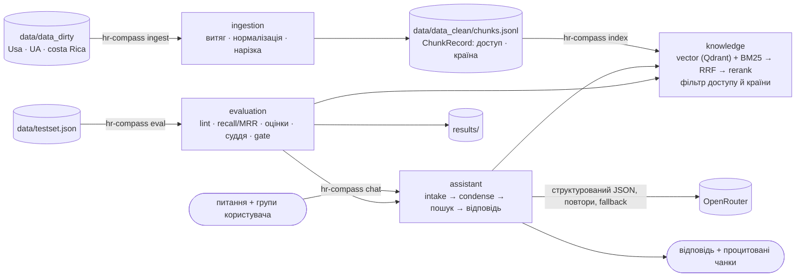

# HR Compass

[English](README.md) | **Українська**

HR-бот: помічник, який відповідає на питання працівників за документами самої компанії (RAG), посилається на
документи, які використав, каже, коли документи питання не покривають, і ніколи не показує документ, який працівник
не має права бачити. Наскрізний проєкт курсу AI Engineer.

## Структура репозиторію

```
main.py              точка входу: python main.py = чат (make run); python main.py run = повний пайплайн (make pipeline)
hr_compass/          сервіс, один пакет на bounded context (див. Архітектура)
config/              settings.toml (усі параметри), access.json (хто що може читати),
                     experiments/ (по конфігу на кожен варіант нарізки: headings / fixed × 120 / 250 токенів)
prompts/             версії промптів + CHANGELOG.md
data/                testset.json (golden set); data_clean/chunks.jsonl + manifest.json (знеособлені чанки, у git);
                     data_dirty/ (вихідні документи) і experiments/ (чанки варіантів нарізки) — у .gitignore
results/             результати оцінок і baseline; experiments/<варіант>/ (статистика чанків і пошук кожного варіанта)
tests/               тести, у тій самій структурі, що й пакет
.github/workflows/   CI: ruff + pytest на кожен push і pull request
REPORT.md            звіт порівняння моделей
```

## Архітектура

Domain-driven design, один пакет на bounded context, у кожному три шари:

| Контекст | Domain (чистий) | Application (use cases, порти) | Infrastructure (адаптери) |
|---|---|---|---|
| `ingestion` | нормалізація, нарізка, дедуплікація, метадані документа | `IngestDocuments` (інкрементальний) | екстрактори PDF / DOCX / HTML, файли датасету |
| `knowledge` | `ChunkRecord`, `AccessPolicy`, `Query` / `Hit`, порти пошуку, RRF | композиція hybrid + rerank, `SearchService` | fastembed, Qdrant, BM25, reranker-и |
| `assistant` | `Reply`, `RagAnswer`, `Intake`, контекст з мітками `[S1]` | `AskQuestion` (RAG) | стійкий LLM поверх OpenRouter |
| `evaluation` | тестовий набір + lint, оцінки, контракт судді, метрики пошуку, gate | оцінка пошуку, оцінка відповідей, суддя | файли тестового набору й результатів |

`shared/` — ядро, яким користуються всі контексти (шляхи, налаштування, логування, шлюз OpenRouter, токенізатор,
файли промптів); `cli/` — командний рядок і **composition root**: єдине місце, яке вирішує, який адаптер реалізує
який порт. Правило залежностей перевіряє `tests/test_architecture.py`: домен не імпортує бібліотек вводу-виводу й
інших шарів, application ніколи не імпортує infrastructure, ядро не імпортує контексти, і жоден модуль не тримає
стан у глобальних змінних (моделі, кеші й клієнти — об'єкти, створені раз на команду).



## Встановлення

Python 3.11+.

```bash
python -m venv .venv
.venv\Scripts\activate            # Windows; Linux/macOS: source .venv/bin/activate
pip install -r requirements.txt    # = pip install -e ".[dev]": пакет, команда `hr-compass`, pytest, ruff
cp .env.example .env               # OPENROUTER_API_KEY — єдиний секрет (потрібен чату й оцінці відповідей)
```

Модель ембедінгів (~220 МБ) і reranker (~80 МБ) завантажуються при першому використанні в `.models/`.

## Запуск однією командою

**Чат на вже підготовлених даних** (`data/data_clean` і кеш векторів):

```bash
make run                                              # = python main.py: інтерактивний чат
python main.py "How many days a week can I work from home?"            # одна відповідь
python main.py "Скільки днів відпустки?" --country UA --groups all_employees,hr --debug
```

`python main.py` — це `hr-compass chat`, і він працює без активації `.venv` (перезапускає себе Python-ом з `.venv`).
Він стартує за кілька секунд, бо нічого не перебудовує. Підготовлені чанки є в git, тож це працює зі свіжого клону.
На новій машині перший старт завантажує локальні моделі (~300 МБ) і векторизує чанки (~1 хв). Якщо даних немає, він
про це каже й підказує `make pipeline`.

**Повний RAG-пайплайн** (окрема команда):

```bash
make pipeline                                         # = python main.py run --check: документи ... -> чат
python main.py run                                    # те саме без перевірок
make prepare                                          # = python main.py run --no-chat --check: лише перебудова й перевірка
```

`python main.py run` — це `hr-compass run`. Він проходить увесь пайплайн по черзі й зупиняється на першому кроці, що
не вдався. Якщо в `[ingest].source_dir` немає документів, він одразу зупиняється й не чіпає підготовлені дані:

```
[1/3] ingest   документи -> чанки            незмінені файли використовуються повторно, повторний запуск ~1 с
[2/3] index    чанки -> вектори -> індекс     вектори з кешу; зупинка, якщо перевірка доступу не пройшла
      checks   (--check) lint тестового набору + gate якості пошуку проти results/retrieval_baseline.json
[3/3] chat     одна відповідь або інтерактивний чат
```

Перший запуск на новій машині ще й завантажує моделі (~300 МБ) і рахує вектори всіх чанків (~1 хв); після цього весь
прогін від документів до відповіді займає близько 6 с. Кожен крок пише свій лог (`logs/ingest.log`, `logs/index.log`,
`logs/eval.log`, `logs/chat.log`). Опції: `--groups`, `--country`, `--model`, `--no-intake`, `--debug` (як у `chat`),
`--full` (обробити всі файли наново), `--check`, `--no-chat`.

## Запуск окремого кроку

```bash
hr-compass ingest                  # документи -> чанки (інкрементально); make ingest
hr-compass index                   # чанки -> вектори (з кешу) -> індекс, перевірка доступу; make index
hr-compass eval lint               # тестовий набір досі відповідає чанкам
hr-compass eval retrieval --gate   # якість пошуку проти baseline; make gate-search
hr-compass chat                    # лише бот (дані мають бути підготовлені); make run, python main.py
hr-compass chat "How many days a week can I work from home?" --groups all_employees --debug
```

`python main.py <команда>` — те саме, що `hr-compass <команда>`.

## Як бот відповідає на питання

```
питання (будь-якою мовою) + групи користувача (+ країна, якщо відома)
  → intake (prompts/intake_v3_en.md): мова, чи про роботу, країна з питання, чи треба уточнення?
  → condense (лише для уточнювальних, prompts/condense_v1.md): «а після 3 років?» → самодостатнє питання
  → пошук ([search].mode, типово hybrid+rerank): лише чанки, які можуть читати групи користувача,
    його країни або загальнокорпоративні
  → контекст: найкращі чанки в межах 1500 токенів, кожен під міткою: [S1] назва · розділ · країна · дата набуття чинності
  → відповідь (prompts/v6_rag_cited.md): JSON {found, answer, citations, confidence, needs_clarification},
    кожне твердження відповіді закінчується міткою свого джерела: «... 24 дні [S1].»
  → перевірка посилань: мітку, якої модель не бачила, відкинуто; мітки перенумеровано [1] [2] у порядку списку
    джерел; твердження без джерела пораховано; немає жодного валідного посилання → «не знайдено»
```

- Не про роботу → ввічлива відмова без виклику моделі відповіді. Потрібне уточнення → одне питання у відповідь.
- Нічого доступного не знайдено → «не знайдено» мовою питання, без виклику моделі відповіді.
- У джерелах кілька країн, а країна невідома → модель відповіді питає, яка саме.
- Intake чи condense впали → бот продовжує без них; відповідь не вдалася на жодній моделі → помилка.

## Дані, доступ і країни

- **Що є в git:** підготовлені чанки `data/data_clean/chunks.jsonl` (1769 чанків із 40 документів) і
  `data/data_clean/manifest.json` (кожен вихідний файл зі статусом, назвою, країною, групами доступу, кількістю чанків і
  хешами вмісту).
  - Обидва побудовані зі знеособлених документів: назви компаній замінено на It-product / It-outsource, імена людей,
    email, телефони й особисті суми замінено, а персональні документи (офери, PDP, таблиці працівників) видалено.
  - Тож `make run` працює зі свіжого клону. Потрібен лише ключ API; локальні моделі завантажуються при першому
    запуску.
- `data/data_dirty/` — вихідні документи. Їх **немає в git** (у .gitignore): `make pipeline` перебудовує з них чанки.
  Вони розкладені за країнами: перша тека з `[ingest.countries]` (`Usa`, `UA`, `costa Rica`) — це країна документа;
  без такої теки — загальнокорпоративний.
- `config/access.json` зіставляє префікс шляху чи glob з групами, які можуть читати; перемагає найдовший збіг, без
  збігу — ніхто. `[access.inherits]` задає ієрархію: `hr`, `managers` і `leadership` включають `all_employees`, тож
  HR-користувач бачить і загальні політики. Доступ забезпечує пошук (фільтр Qdrant, BM25 перевіряє те саме правило), а
  не промпт.

## Ingestion

`hr-compass ingest` перетворює кожен PDF / DOCX / HTML на нормалізований markdown і записи чанків у `data/data_clean/`:
`chunks.jsonl`, по одному `<файл>.md` на документ, `manifest.json` (dataset_version: ті самі входи, пайплайн і правила
дають той самий id), `_report.json` і `audit.jsonl` (журнал лише на дописування: що сталося з кожним файлом у кожному
прогоні). Інкрементально: незмінений файл використовується повторно з початковим `ingested_at`; групи доступу й країни
перераховуються щоразу, тож зміна правил не потребує повторного ingest; файл, що зник із входу, втрачає свої чанки.
Скани без текстового шару й непідтримувані типи потрапляють у звіт, а не в індекс. `--full` — усе наново.
Зміна нарізки (`strategy`, `chunk_tokens`, `fixed_overlap`) теж один раз обробляє все наново; тексти, що вийшли
такими самими, зберігають свої вектори з кешу. Кожен запуск має власний id (час старту в UTC з мікросекундами, завжди
пізніший за id попереднього запуску). Тож два запуски в межах одного тіку годинника Windows (~15 мс) ніколи не мають
спільного id, і їхні події в `audit.jsonl` не змішуються.

Чанки (`[ingest].strategy = "headings"`): поділ за заголовками, цілі абзаци / пункти списків / рядки таблиць
пакуються до 120 токенів (шматок таблиці повторює її заголовок), шлях розділу стоїть перед текстом для ембедінгу. Друга
стратегія, `"fixed"`, — ковзне вікно з `chunk_tokens` токенів, сусідні вікна мають `fixed_overlap` = 20 спільних
токенів; чому за замовчуванням headings-120, виміряно [нижче](#стратегія-нарізки-headings-проти-fixed).

### Розмір чанків: перша нарізка (ліміт 120 токенів)

За замовчуванням нарізка йде з `[ingest].chunk_tokens = 120` (токени `cl100k_base`). Ліміт м'який: чанк складається з
цілих одиниць (речення, рядок таблиці, пункт списку), а одиниця, довша за ліміт, ніколи не розрізається. На 1769
чанках поточного (знеособленого) корпусу:

| | токени |
|---|---|
| медіана / середнє | 90 / 84 (медіана ~470 символів, приблизно абзац) |
| p10 / p90 / p95 | 39 / 117 / 119 |
| min / max | 3 / 192 |

| розмір, токени | 0–19 | 20–59 | 60–99 | 100–120 | понад 120 |
|---|---|---|---|---|---|
| чанків | 37 | 350 | 695 | 630 | **57** |

**57 чанків довші за ліміт** (до 192 токенів). Чому:

| Причина | Чанків | Що відбувається |
|---|---|---|
| одне довге речення | 41 | Переважно юридичні речення довідника й договорів (130–190 токенів). Частина — зовсім не речення: список із PDF, що при витяганні втратив маркери й крапки («Key Responsibilities Support property evaluation… Analyze… Review…», 144 токени), не дає роздільнику речень місця для розрізу |
| заголовки + текст | 14 | Заголовки розділу переносяться в його перший чанк. Список, перший пункт якого з відступом, не розпізнається як список і ріжеться за реченнями, а не за пунктами (чанк на 191 токен, найбільший пункт якого — 25 токенів) |
| один пункт списку | 1 | один довгий пункт |
| інше | 1 | блок із кількох частин, який пакувальник не зміг розділити далі |

**Чому це важливо.** Модель ембедінгів (`paraphrase-multilingual-MiniLM-L12-v2`) читає приблизно 128 токенів власного
токенізатора й мовчки відкидає решту. Тож кінець цих чанків, найімовірніше, не потрапляє в їхні вектори. BM25 бачить
увесь текст, тому гібридний пошук частково це компенсує.

Що спробувати, перевіряючи кожну зміну gate пошуку:
- жорсткий запасний розріз (за рядками, потім за словами) для одиниці, що й далі довша за ліміт;
- розпізнавання пунктів списку з відступом;
- модель ембедінгів, що читає 512 токенів (наприклад, `paraphrase-multilingual-mpnet-base-v2`) або більше.
  Провайдерська модель у REPORT, частина A, читає ~8k токенів.

### Стратегія нарізки: headings проти fixed

**Коротко:** за замовчуванням — headings на 120 токенів.
- **Найкращі recall@5 / MRR у пошуку чату:** hybrid+rerank 0.87 / 0.75 проти 0.78 / 0.69 у fixed-120.
- **Найменший контекст:** 438 токенів у топ-5.
- **Чисті розрізи:** лише 5 % чанків починаються посеред речення, у fixed — 69 %.

Fixed — запасний варіант для тексту без структури.

**Постановка.** Дві стратегії у двох розмірах, на всьому корпусі (40 документів) і 23 питаннях тестсету, що мають
відповідь. Кожен варіант має власний конфіг у `config/experiments/`, зі своєю текою виходу, кешем векторів і текою
результатів, тож основний індекс не чіпається. Усе працює локально й безкоштовно:

```bash
hr-compass --config config/experiments/fixed-120.toml run --no-chat        # ingest + index цього варіанта
hr-compass --config config/experiments/fixed-120.toml eval chunks          # як він ріже корпус
hr-compass --config config/experiments/fixed-120.toml eval retrieval --lenient
```

`--lenient`: цитата тестсету, яку жоден чанк не містить цілою (розрізана нарізкою), рахується як промах, а не як
помилка. Жоден варіант не розрізав жодної з 24 цитат, тож усі чотири виміряні на тих самих питаннях.

**Як кожен варіант ріже корпус** (`eval chunks`, токени `cl100k_base`):

| | headings-120 | fixed-120 | headings-250 | fixed-250 |
|---|---|---|---|---|
| чанків | 1769 | 1504 | 1034 | 665 |
| медіана / p95 / max токенів | 90 / 119 / 192 | 120 / 120 / 120 | 149 / 246 / 251 | 250 / 250 / 250 |
| понад ліміт | 57 | 0 | 2 | 0 |
| починаються посеред речення | **95 (5 %)** | 1045 (69 %) | **47 (5 %)** | 451 (68 %) |
| розрізаних рядків таблиць | 1 | 14 | 1 | 4 |
| менше 20 токенів | 37 | 0 | 19 | 0 |
| без шляху розділу | 13 | 1504 (усі) | 9 | 665 (усі) |

**Пошук** (`eval retrieval`, локальні ембедінги, recall@5 / MRR; ctx — середня кількість токенів у топ-5 чанках, тобто
що читає модель відповіді):

| конфігурація | headings-120 | fixed-120 | headings-250 | fixed-250 |
|---|---|---|---|---|
| vector | **0.74** / 0.62 | **0.74** / 0.54 | 0.70 / **0.64** | 0.61 / 0.49 |
| bm25 | 0.52 / 0.39 | 0.61 / 0.42 | 0.57 / 0.42 | **0.65** / **0.47** |
| hybrid | 0.74 / 0.61 | **0.87** / **0.64** | 0.74 / 0.62 | 0.74 / 0.60 |
| **hybrid+rerank** (чат) | **0.87** / **0.75** | 0.78 / 0.69 | **0.87** / 0.72 | 0.78 / 0.69 |
| ctx токенів, hybrid+rerank | **438** | 589 | 696 | 1201 |

З провайдерською моделлю ембедінгів (`openai/text-embedding-3-large`) картина нарізки та сама: headings-120 найкращий
або нарівні з найкращим, з найменшим контекстом. Сам векторний пошук там дає 0.96 / 0.84. Див. REPORT, частина A.

**На кількох документах** (загальнокомпанійних, 120 токенів):
- fixed ріже посеред речення в 5 із цих 6 документів;
- headings — лише в довгому довіднику, де одне речення довше за ліміт.

| документ | headings-120: чанків / посеред речення / розрізаних таблиць | fixed-120 |
|---|---|---|
| Handbook (US) 2026 | 301 / 17 / 0 | 252 / 188 / 1 |
| Onboarding Process EU | 16 / 0 / 0 | 10 / 5 / 2 |
| Onboarding and Adaptation Process | 12 / 0 / 0 | 9 / 5 / 0 |
| Vacation Policy Overview & FAQ | 8 / 0 / 0 | 8 / 4 / 0 |
| Commuter Benefits Policy | 7 / 0 / 0 | 4 / 0 / 0 |
| HR – Paid Vacation | 6 / 0 / 0 | 5 / 2 / 0 |

**Вибір: headings, 120 токенів** (за замовчуванням у `config/settings.toml`). Чому:

- **Найкраще там, де це важливо.** Чат шукає через hybrid+rerank, і там headings-120 має найкращі recall і MRR
  (0.87 / 0.75). Fixed із реранкером втрачає 2 питання. Вікно, що починається посеред речення й змішує кінець одного
  правила з початком наступного, — гірший уривок для cross-encoder.
- **Чому саме так різати.** HR-документи написані розділами («Paid Vacation > New Hires») зі списками й таблицями.
  - Нарізка за заголовками зберігає правило, список чи рядок таблиці цілими, тож знайдений чанк можна цитувати й
    посилатися на нього як є.
  - Кожен чанк знає свій розділ, який показують заголовок контексту й цитати.
  - Фіксоване вікно взагалі не має шляху розділу, приблизно в 70 % чанків починається посеред речення й відрізає
    рядки таблиць від їхнього заголовка.
- **Чому такий розмір.** 120 токенів `cl100k` — це приблизно абзац або одне правило, і він вміщується у вікно моделі
  ембедінгів (MiniLM читає ~128 власних токенів і відкидає решту). При 250 токенах:
  - вектор бачить лише першу половину чанка, і recall самого векторного пошуку падає (0.74 → 0.70 для headings);
  - контекст топ-5 зростає в 1.6 раза (headings) — 2.7 раза (fixed). Це коштує токенів на кожній відповіді й лишає
    менше з бюджету контексту в 1500 токенів.
- **У чому fixed добрий.** Більші й рівні чанки допомагають пошуку за словами: fixed-120 hybrid без реранкера дає
  0.87 / 0.64. Fixed не потребує структури, тож це запасний варіант для тексту без заголовків (плаский PDF, лист).
- **Коли переміг би інший вибір:**
  - без реранкера (він додає ~0.6 с на запит на CPU ноутбука) найсильніший локальний варіант — fixed-120 hybrid;
  - з моделлю ембедінгів, що читає довгі тексти (провайдерська, REPORT, частина A), чанки на 250 токенів нічого не
    втрачають у recall, але все одно подвоюють контекст.

**Застереження.**
- 23 питання — маленький набір. Одне питання — це 0.04 recall, тож різниця в одне-два питання в межах шуму. Чіткі
  сигнали — якість розрізу (початок посеред речення, розрізані таблиці, відсутній шлях розділу) і розмір контексту.
- З перекриттям цитата може лежати у двох сусідніх вікнах, що трохи підвищує recall для fixed.

## Пошук

| Конфігурація | Як | Сильна сторона |
|---|---|---|
| `vector` | запит перетворюється на вектор (`paraphrase-multilingual-MiniLM-L12-v2`, fastembed), косинус у Qdrant | інше формулювання, інша мова |
| `bm25` | пошук за словами по шляху розділу + тексту | точні коди й назви (`DB-450`, `PFL-DC`) |
| `hybrid` | топ-20 обох, злиті Reciprocal Rank Fusion, 1 / (60 + ранг) | обидва; ранги, а не оцінки (різні шкали) |
| `hybrid+rerank` | 20 гібридних кандидатів пересортовує cross-encoder (`ms-marco-MiniLM-L-6-v2` або OpenRouter `/rerank` при `[search].reranker = "openrouter"`) | правильний чанк угорі; повільніше |

```bash
hr-compass search "DB-450" --groups all_employees,hr --config hybrid+rerank    # make search QUERY="..."
hr-compass eval retrieval                  # recall@5 / MRR / токени контексту за конфігураціями -> results/retrieval_eval.json
hr-compass eval chunks                     # як нарізка ріже корпус -> results/chunk_stats.json
hr-compass eval pairs --skip-archived      # семантичні майже-дублікати з різних документів
```

Якість пошуку на 23 кейсах з відповіддю (headings-120, локальні ембедінги, ноутбук без GPU, моделі завантажені;
baseline у `results/retrieval_baseline.json`):

| Конфігурація | recall@5 | MRR | мс/запит | перефразування (11) | точні (4) | крос-мовні (4) | доступ (2) | застарілі (2) |
|---|---|---|---|---|---|---|---|---|
| vector | 0.74 | 0.62 | 66 | 0.82 | 0.50 | 0.75 | 1.00 | 0.50 |
| bm25 | 0.52 | 0.39 | 2 | 0.64 | 1.00 | 0.00 | 0.50 | 0.00 |
| hybrid | 0.74 | 0.61 | 23 | 0.73 | 0.75 | 0.75 | 1.00 | 0.50 |
| hybrid+rerank | **0.87** | **0.75** | 568 | 1.00 | 1.00 | 0.50 | 1.00 | 0.50 |

Leaks (повернуті чанки, які користувач не має права бачити): 0 у кожній конфігурації. Reranker навчений англійською:
для українських питань він гірший за сам векторний пошук (0.50 проти 0.75). З провайдерською моделлю ембедінгів сам
векторний пошук дає 0.96 / 0.84, а локальний реранкер лише знижує результат (REPORT, частина A).

### Модель ембедінгів: локальна чи OpenRouter

`[embeddings].provider` визначає, хто перетворює текст на вектори; обидва варіанти працюють через той самий кеш
(`sha256(модель + текст)`, окремий файл на модель у `.cache/embeddings/`), тож перемикання туди-назад після першого
запуску нічого не коштує.

| | `provider = "local"` (типово) | `provider = "openrouter"` |
|---|---|---|
| модель | `sentence-transformers/paraphrase-multilingual-MiniLM-L12-v2` (fastembed, ONNX, CPU) | наприклад `openai/text-embedding-3-large` через `POST /embeddings` |
| вектор / читає | 384 виміри / ~128 токенів (довші чанки обрізаються) | 3072 виміри / ~8 тис. токенів |
| вартість | безкоштовно; ~220 МБ завантаження | ~$0.13 за 1 млн токенів: близько $0.015 за разову індексацію цього корпусу, запити — копійки |
| дані | не залишають машину; працює офлайн | **текст кожного чанка один раз надсилається провайдеру** (офери, зарплати, PDP); кожне питання потребує мережі |

```toml
[embeddings]
provider = "openrouter"
model = "openai/text-embedding-3-large"
dim = 3072
```

далі `python main.py run --no-chat --check` (`make prepare`): кожен чанк векторизується новою моделлю (потрібен ключ API), а gate пошуку
порівнює recall@5 / MRR зі збереженим baseline. Документи векторизуються з кешем, пошукові запити — без нього (вони
рідко повторюються). Виклики йдуть через OpenRouter-клієнт проєкту (таймаути, повтори, токени й вартість у лозі).

## Оцінка

`data/testset.json` — golden set: 26 кейсів, у кожного групи користувача `groups`, релевантні чанки `relevant` (цитати,
тож розмітка переживає повторну нарізку), факти `must`, які мають бути у відповіді (з кожної групи — один варіант;
українські варіанти для українських відповідей), і еталонна відповідь `reference`. Види: paraphrase 11, exact 4,
cross-lingual 4, access 2, stale 2 (архівний довідник каже інше), no_answer 3 (бот має відмовитися).

```bash
hr-compass eval lint                                   # перевірити самі тести: без моделі, exit 1, якщо є проблеми
hr-compass eval retrieval --save-baseline | --gate     # gate якості пошуку (results/retrieval_baseline.json)
hr-compass eval retrieval --lenient                    # інша нарізка: розрізана нею цитата — промах, а не помилка
hr-compass eval chunks                                 # розміри чанків, початок посеред речення, розрізані таблиці, понад ліміт
hr-compass eval answers --judge                        # справжній бот на кожному кейсі (викликає модель); make eval-answers
hr-compass eval answers --models gpt4omini,haiku,deepseek --judge   # таблиця порівняння моделей; make compare
hr-compass eval answers --repeat 3                     # pass@1, пройшло в кожному прогоні, нестабільні кейси
hr-compass eval answers --save-baseline | --gate       # gate якості відповідей (results/answers_baseline.json)
hr-compass eval calibrate                              # суддя проти відповідей, розмічених людьми (data/labels.json)
```

- **chunks** (безкоштовно, без моделі): кількість чанків, медіана / p95 / max токенів, чанки понад
  `[ingest].chunk_tokens`, чанки, що починаються посеред речення, розрізані рядки таблиць, чанки менше 20 токенів і
  чанки без шляху розділу. Разом із `retrieval --lenient` порівнює нарізки
  ([Стратегія нарізки](#стратегія-нарізки-headings-проти-fixed)).
- **retrieval** також показує `ctx tok`: середню кількість токенів у топ-k чанках — саме це читає модель відповіді й
  за це платять.
- **lint** повідомляє, по рядку на проблему: відсутні поля, дублікати id, цитати, що не знаходять жодного чанка,
  архівні чи недоступні релевантні чанки, факти `must`, яких немає в релевантних чанках чи в еталоні, no_answer-кейси з
  фактами, види, де менше 2 кейсів.
- **Детерміновані оцінки** (безкоштовно): `facts` (кожна група `must` є у відповіді), `cited` (серед процитованих є
  релевантний чанк), `abstain` (no_answer: бот сказав, що не знайшов), `pass`; плюс `false_abstain`, pass за видами,
  вартість, затримка p50/p95.
- **LLM-суддя** (`prompts/judge-v3/`): коректність проти еталону (оцінює так/ні, перефразування, інші мови) і
  обґрунтованість проти процитованих джерел (ловить відповідь, яка цитує правильний чанк і все одно вигадує правило).
- **Калібрування судді** (`eval calibrate`, ~$0.003): суддя проти відповідей, які розмітила людина.
  - `data/labels.json` містить 30 реальних відповідей останнього прогону: кожен кейс один раз, три моделі по черзі,
    плюс 4 кейси, де оцінки розходяться.
  - У файлі є питання, еталон і відповідь. Вердикт судді навмисно не показано, щоб він не впливав на розмітку.
  - Для кожної відповіді постав `"correct"`: `true` або `false`; якщо є сумнів, додай `"note"`.
  - Команда відмовляється запускатися, поки хоч одна відповідь `null`, ще до будь-якого платного виклику.
  - Вона показує згоду, false pass і false fail судді та детермінованого `pass`, а також id, де суддя і людина
    розходяться.
  - Якщо згенерувати файл заново з нового прогону, розмітка перезапишеться, тож зберігай розмічені файли.
- **Gate**: кожне число baseline, що погіршилося більш ніж на 0.05 (`false_abstain` і leaks — зросли), кожне число
  baseline, яке тепер не виміряно, кожен кейс, що проходив і тепер падає (`regression: q16`) → exit 1. Перевірено
  навмисно: зміна токенізатора, що відкидає слова коротші за 6 літер, знизила recall hybrid+rerank з 0.83 до 0.70 (на
  корпусі до знеособлення), і gate впав з 11 регресіями.

Кожен файл результатів містить `dataset_version` і `fingerprint` налаштувань (sha256 чинних налаштувань без ключа),
тож будь-яке число можна відтворити. Живі тести судді: `HR_COMPASS_LIVE=1 python -m pytest
tests/evaluation/test_judge.py` (~$0.001).

## Логування

Кожен компонент пише свій файл `logs/<компонент>.log` (`ingest`, `index`, `search`, `chat`, `eval`; JSON-рядки, ротація
5 МБ × 5) плюс читабельний текст у консоль. Рядок у файлі:

```json
{"ts": "...", "level": "INFO", "logger": "hr_compass.assistant.application.ask_question", "component": "chat",
 "run_id": "-", "request_id": "a3065fc3", "doc": "-", "msg": "ask done", "kind": "answer", "found": true,
 "cited": 1, "context_tokens": 607, "model": "openai/gpt-4o-mini", "input_tokens": 1859, "cost": 0.000335, "ms": 6289}
```

- `run_id` пов'язує прогін ingest, `request_id` — питання, `doc` — документ:
  `jq 'select(.doc=="b74f157d2a1d")' logs/ingest.log` — історія одного файлу.
- Кожен пошук логується: режим, групи, країна, найкращі результати як `<хеш документа>#<чанк>:<оцінка>`, час.
- **Приватність**: ключ API не логується ніколи. Тексти питань і чанків, шляхи й назви документів (у них імена людей)
  потрапляють лише на DEBUG (`-v` / `--debug`); рядки INFO містять розміри, хеш-посилання, оцінки, токени, вартість і час.
- `--log-file <шлях>` або `HR_COMPASS_LOG_FILE` замінює файл; `off` вимикає його.

## Налаштування

Усе, що можна налаштувати, — у `config/settings.toml`; невідомий ключ чи неправильне значення — помилка при старті.

| Секція | Що |
|---|---|
| `[openrouter]`, `[models]`, `[pricing]` | основна модель, псевдоніми для `--model` / `--models`, ціни |
| `[generation]` | temperature (0), top_p, max_tokens |
| `[timeout]` | Патерн 1: таймаути connect/read/write/pool + жорсткий дедлайн на спробу |
| `[retry]` | Патерн 2: повтор на 429/5xx/таймаутах з експоненційною паузою, jitter, `Retry-After` |
| `[structured_output]` | Патерн 3: `json_schema` у кожному запиті, валідація pydantic, запити на виправлення |
| `[fallback]` | Патерн 4: наступна модель, коли в однієї скінчилися спроби; не для 400-403 |
| `[ingest]`, `[ingest.countries]` | теки, стратегія нарізки (headings / fixed), розмір чанка, перекриття для fixed, токенізатор, маркер архіву, теки країн |
| `[embeddings]` | провайдер (local / openrouter), модель, розмірність, batch, теки моделей і кешу |
| `[search]` | режим, k, кандидати, RRF k, reranker (local / openrouter) |
| `[rag]` | промпти відповіді / intake / condense, кількість реплік історії, бюджет контексту |
| `[access]`, `[access.inherits]` | файл правил, типові групи, ієрархія груп |
| `[eval]` | тестовий набір, розмітка, тека результатів, допуск gate, промпти судді |
| `[logging]` | тека логів, ротація |

## Тести

```bash
python -m pytest -q        # make test: ~380 тестів, офлайн (моделі й API підмінені), ~7 с
python -m ruff check .     # make lint
```

Тести повторюють структуру пакета (`tests/<контекст>/`), використовують явні підробки (`tests/fakes.py`) замість
підміни глобальних змінних модулів і включають правило архітектури, INFO-логи без персональних даних і наскрізний
запуск CLI з підміненим API. Деякі тести пропускаються самі:
- тести, яким потрібні завантажені моделі, доки `hr-compass index` їх не завантажить;
- тести реального тестсету проти корпусу, доки не запущено `hr-compass ingest`;
- живі тести судді, якщо не задано `HR_COMPASS_LIVE=1`.

**CI** (`.github/workflows/tests.yml`, GitHub Actions) запускає `ruff check` і `pytest` на кожен push і pull request,
на Python 3.11 і 3.12. Тест, що впав, або помилка лінтера валять прогін. На машині CI є закомічені чанки, тож
перевірки реального тестсету проти них теж запускаються. Вихідних документів, моделей і ключа API там немає: 381 тест
проходить, 5 пропущено (тести із завантаженими моделями та живого судді); перевірено на копії репозиторію лише з
файлами з git.

Evals з порогами в CI не запускаються: корпус у `.gitignore`, бо в ньому були персональні дані. Запускайте їх локально
перед релізом:
- `hr-compass eval retrieval --gate` (безкоштовно);
- `hr-compass eval answers --gate` (платно).
