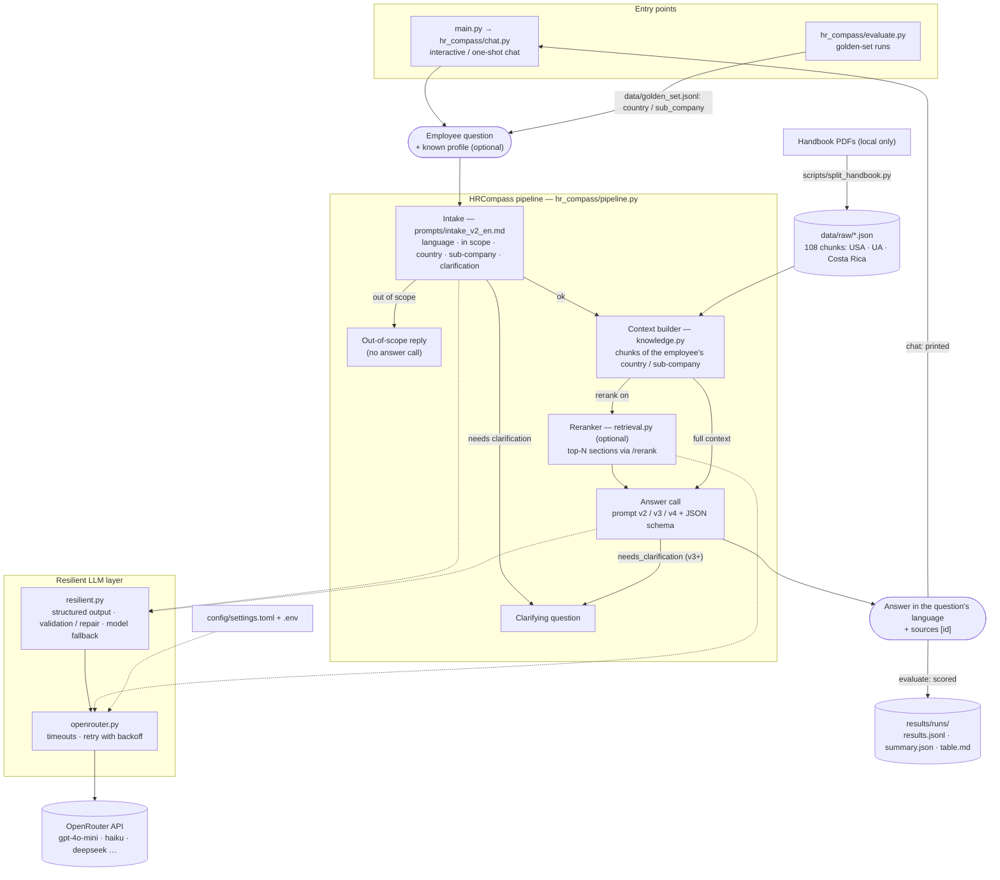

# HR Compass

[English](README.md) | **Українська**

HR-бот — помічник для персоналу, що відповідає на питання, пов'язані з компанією.
Наскрізний проєкт курсу AI Engineer.

## Структура репозиторію

```
main.py           точка входу
hr_compass/       код сервісу
prompts/          версії промптів + CHANGELOG.md
data/             тексти (база знань) та golden set
scripts/          нарізка PDF-довідника на чанки (split_handbook.py)
results/          виходи моделей
tests/            тести
REPORT.md         звіт-порівняння
```

## Схема



Запасні шляхи, яких немає на схемі: для профілю немає розділів → береться весь довідник; rerank-запит не вдався →
повний контекст; intake не спрацював → бот відповідає без нього.

## Що потрібно встановити

- Python 3.11+

## Запуск

```bash
python -m venv .venv
.venv\Scripts\activate          # Windows; Linux/macOS: source .venv/bin/activate
pip install -r requirements.txt  # або make install
cp .env.example .env             # вписати ключі
python main.py                   # або make run
```

## Як працює сервіс

```
питання (будь-якою мовою)
  → intake (prompts/intake_v2_en.md): мова, чи в межах теми, країна/підкомпанія, чи потрібне уточнення
  → контекст: увесь довідник (data/raw) або, з --rerank, top-N розділів від reranker-а
  → відповідь: контекст у системному промпті + питання → JSON за схемою
  → текст відповіді мовою питання + джерела [id]
```

- Поза темою — ввічлива відмова без виклику основної моделі (економія токенів).
- Потрібне уточнення — бот ставить одне питання; наступна репліка об'єднується з початковим питанням.
- Якщо в довіднику немає розділів для країни/підкомпанії з intake — береться весь довідник.
- Якщо intake не спрацював — бот відповідає без нього.

```bash
python main.py                                  # інтерактивний чат (вихід: exit)
python main.py "Скільки днів відпустки в part-time?"   # одне питання
python main.py "..." --model haiku --debug      # модель-псевдонім; intake, токени, вартість
python main.py "..." --no-intake                # без intake
python main.py "..." --rerank                   # лише top-N релевантних розділів замість усього довідника
```

Моделі задаються псевдонімами в `[models]` файлу `config/settings.toml` (або повним slug OpenRouter).

### Reranker (секція `[rerank]`)

Замість усього довідника (~27k токенів) у промпт потрапляють лише `top_n` розділів, які rerank-модель
(`nvidia/llama-nemotron-rerank-vl-1b-v2:free` через `POST /rerank` OpenRouter, безкоштовна) вважає найрелевантнішими
питанню. За замовчуванням вимкнено (`enabled = false`); вмикається в конфігу або прапорцем `--rerank` / `--no-rerank`
(і в `main.py`, і в `hr_compass.evaluate`). Rerank-запит має ті самі таймаути/повтори, що й основна модель; якщо він
усе ж не вдався — відповідь будується з повним контекстом. В оцінці прогони з rerank мають суфікс `_rerank` у назві
папки, а в `results.jsonl` поле `retrieved` містить id відібраних розділів.

```bash
python -m hr_compass.evaluate --prompt prompts/v2_structured.md --rerank   # порівняти з тим самим прогоном без --rerank
```

## Логування

Лог пишеться у `logs/hr_compass.log` (ротація 1 МБ × 3; `*.log` у `.gitignore`) і в консоль (stderr).
Консоль для чату показує лише WARNING+, файл — INFO+; `--debug` вмикає DEBUG в обох місцях.
Шлях змінюється `--log-file <шлях>` або змінною `HR_COMPASS_LOG_FILE`; `off` вимикає файл.

Що логується: завантаження конфігурації й довідника, кожен виклик моделі (модель, спроба, токени, вартість, затримка),
повтори/відмови/fallback, результат intake, рішення пайплайну (поза темою / уточнення / відповідь, джерела, підсумкова
вартість), старт і завершення сесії. Кожне питання (або зразок оцінки) має короткий id у квадратних дужках, за яким
легко зібрати всі рядки одного запиту.

Приватність: ключ API не логується взагалі; текст питання потрапляє в лог лише на рівні DEBUG (на INFO — тільки його довжина).

## Порівняння моделей

```bash
make compare MODELS=haiku,deepseek              # або: python -m hr_compass.evaluate --prompt prompts/v2_structured.md --models haiku,deepseek
```

Кожна модель проганяється окремо (fallback вимкнено, щоб модель не підмінялася), результати — у `results/runs/`,
зведена таблиця для `REPORT.md` — `results/runs/<час>_compare_<промпт>.md`.

## Оцінка промптів через OpenRouter

1. У `.env` вкажіть `OPENROUTER_API_KEY` (єдиний секрет).
2. Усі інші налаштування — у `config/settings.toml` (модель, паралелізм, патерни надійності нижче).
3. Додайте питання у `data/golden_set.jsonl` (формат — у коментарях файлу).
4. Запустіть:

```bash
make eval
python -m hr_compass.evaluate --prompt prompts/v2_structured.md --samples data/golden_set.jsonl --limit 3
```

Кожне питання проходить той самий шлях, що й у чаті: intake → контекст → відповідь. `country` / `sub_company` із golden
set — це профіль співробітника, відомий боту заздалегідь (країна, названа в самому питанні, має пріоритет).
`expected_kind` (`answer` / `clarification` / `out_of_scope`) перевіряє тип відповіді — колонка «Тип відповіді, %».
`--no-intake` — викликати модель відповіді напряму (тоді кожна відповідь — `answer`); intake вимикається й автоматично,
якщо `[structured_output].enabled = false` (напр. для `v1_baseline`). Вартість і токени включають виклик intake.

Результати: `results/runs/<час>_<модель>_<промпт>/results.jsonl` (відповідь, тип відповіді, джерела, впевненість, модель, токени, вартість, затримка) та `summary.json`
(параметри семплінгу прогону з `[generation]` — `temperature`, `top_p`, `max_tokens`; затримка — середня, p50 і p95 за
успішними зразками; перцентилі — nearest-rank, тож на малій вибірці p95 ≈ найповільніший запит).
Код завершення ненульовий, якщо хоч один запит не вдався.

### Патерни надійності (секції `config/settings.toml`)

| Патерн | Секція | Що робить |
|---|---|---|
| Timeout | `[timeout]` | таймаути connect/read/write/pool + жорсткий дедлайн однієї спроби (`attempt_s`) |
| Retry з backoff | `[retry]` | повтор при 429/5xx/таймаутах: `base_delay_s * multiplier^n`, обмеження `max_delay_s`, jitter, `Retry-After` |
| Structured output + валідація | `[structured_output]` | `json_schema` у запиті, валідація pydantic (`hr_compass/schema.py`), `max_repair_attempts` запитів на виправлення |
| Fallback | `[fallback]` | якщо модель вичерпала спроби або віддає невалідний JSON — наступна з `models`; не для `skip_statuses` (401/402/403) |

Для вільного тексту (`prompts/v1_baseline.md`) вимкніть `structured_output.enabled`.